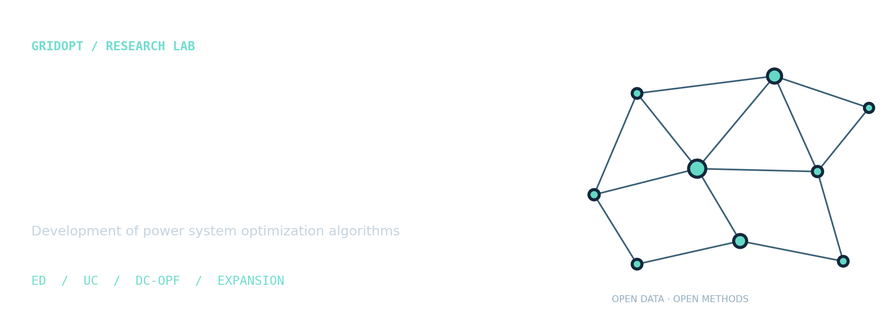
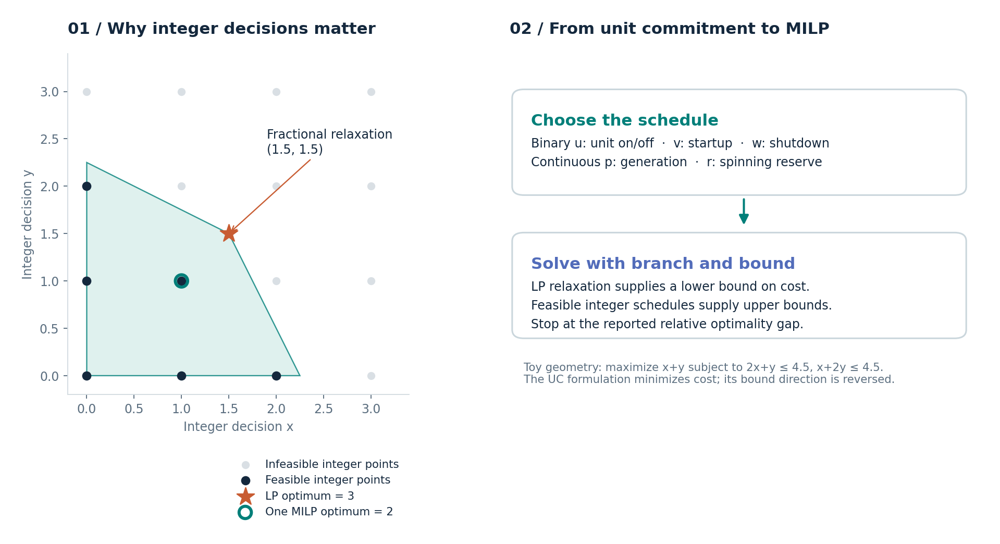
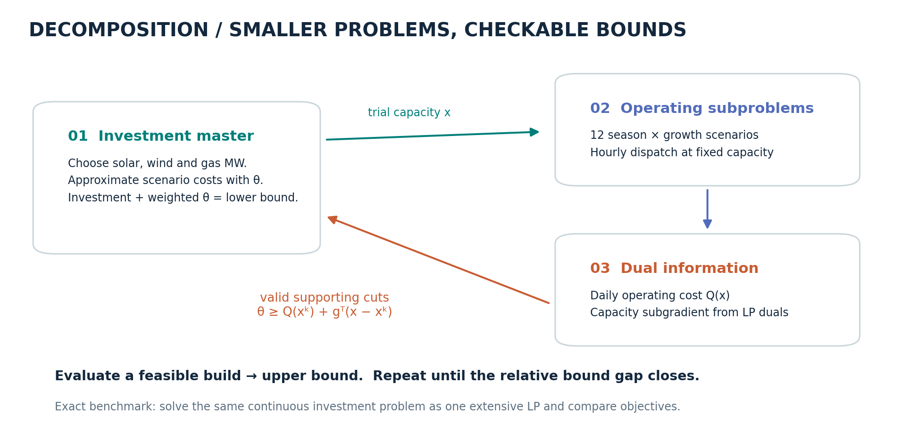
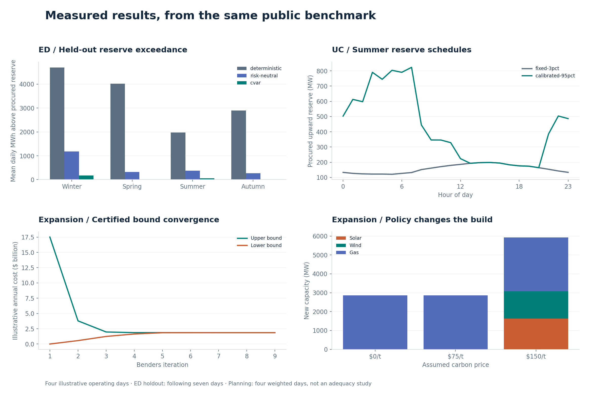
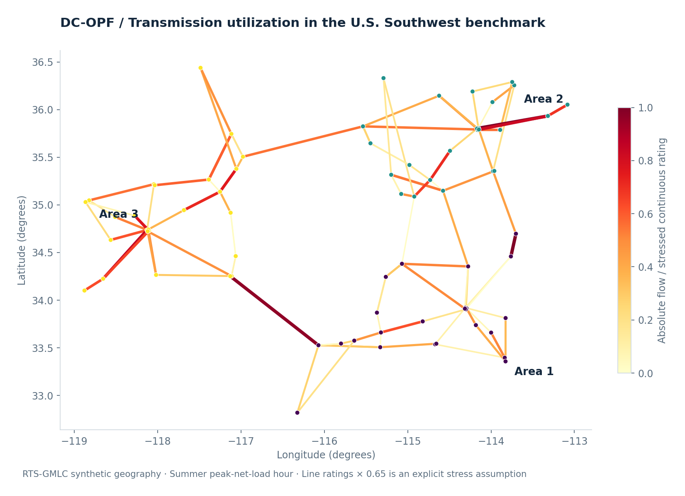

<div align="center">



# GridOpt Lab

**Development of power system optimization algorithms**

Economic dispatch · Unit commitment · Optimal power flow · Expansion planning

[](https://github.com/BehnamMohseniGharyehsafa/gridopt-lab/actions/workflows/ci.yml)
[](pyproject.toml)
[](https://highs.dev/)
[](LICENSE)
[](docs/data.md)

[**Read the visual research report →**](https://BehnamMohseniGharyehsafa.github.io/gridopt-lab/) · [Equations](docs/formulations.md) · [Results](results/reference/analysis.md) · [Get started](#run-the-lab)

</div>

An open, runnable research lab for decisions across four power-system timescales. It pairs sparse optimization models with a pinned U.S. benchmark, chronological forecast evaluation, independent reference formulations, and figures you can regenerate.

**73 buses · 120 AC branches · 73 thermal generators · 8,784 hourly profiles**

The data come from [RTS-GMLC](https://github.com/GridMod/RTS-GMLC), a synthetic system assigned to the U.S. Southwest with geographically consistent load, wind and solar profiles. These are realistic benchmark inputs modeling 2020, rather than measured dispatch from an actual utility. [Source provenance and transformations →](docs/data.md)

## Four models, four checkable experiments

| Decision | Baseline | Advanced method | Evidence |
| :-- | :-- | :-- | :-- |
| **Economic dispatch** | Energy-only, zero purchased reserve | Energy/reserve co-optimization with empirical CVaR; risk-neutral ablation | Previous 30 days train; following 7 days evaluate reserve exceedance |
| **Unit commitment** | Fixed reserve of 3% of gross load | MILP with hour-conditioned forecast-error quantiles and valid symmetry reduction | Balance, ramps, binary transitions, minimum times, actual MIP gaps |
| **DC optimal power flow** | All 120 branch-limit pairs | Iterative constraint generation with a full-network termination check | Same optimal objective as the full-limit LP |
| **Generation expansion** | Extensive two-stage stochastic LP | Multicut Benders decomposition using capacity duals | Converging bounds; objective agreement at three carbon prices |

**Research positioning.** CVaR, MILP, constraint generation and Benders are established methods. This project develops an exploratory integration of empirical forecast calibration, explicit risk budgets and auditable decomposition. It makes no claim of algorithmic priority or state-of-the-art performance. The current models are separate experiments over shared data; planning does not embed the UC or network models. [Hypotheses, ablations and next experiments →](docs/research.md)

## See the optimization



Continuous dispatch and discrete commitment decisions require different solution machinery. The toy geometry above illustrates why rounding an LP solution is insufficient.



The planning master proposes a build. Operating subproblems return costs and valid cuts. Upper and lower bounds close until the same objective is recovered as the extensive LP.

## Measured results



Every plotted number is generated by the code and exported in [CSV/JSON](results/reference/). Read the [result interpretation](results/reference/analysis.md), including procurement costs, solver gaps and limitations. The reference run includes four seasonal operational days, two network-rating levels, and three planning carbon prices.

- Reserve exceedance measures forecast error beyond purchased reserves. It is **not an outage or load-shedding estimate**.
- OPF screening is checked against every final line rating and the full-limit LP. Fewer constraints do not by themselves establish a speedup.
- UC can return a validated feasible incumbent after 45 seconds; its actual gap and bound are retained. Small policy cost differences need to be read alongside those gaps.
- Planning uses four hand-selected representative days and disclosed growth/retirement assumptions. Its annualized result is an illustration, not an investment recommendation or resource-adequacy conclusion.

## Run the lab

Python 3.11–3.13. No commercial solver, API key, or data download is needed for the bundled experiments.

```bash
git clone https://github.com/BehnamMohseniGharyehsafa/gridopt-lab.git
cd gridopt-lab
python -m venv .venv
```

Activate the environment:

```bash
# macOS / Linux
source .venv/bin/activate
```

```powershell
# Windows PowerShell
.venv\Scripts\Activate.ps1
```

Install and run from the repository checkout:

```bash
python -m pip install -e ".[dev]"
gridopt validate
python -m pytest -q
gridopt run --quick --output results/runs/quick
gridopt run --output results/runs/my-run
gridopt report --input results/runs/my-run
```

Open `docs/index.html` for the self-contained interactive report. It embeds its figures and tables, supports keyboard navigation, and works offline. `gridopt report` regenerates the documentation figures and report from the selected run. An ordinary full run may take several minutes because UC has a 45-second limit per policy and day. Runtime depends on the machine and solver version.

To use the exact numerical dependency versions from the reference environment:

```bash
python -m pip install -r requirements-lock.txt
python -m pip install --no-deps -e .
```

The lock file pins direct numerical dependencies; it is not a complete transitive/environment lock. Runtime and MIP incumbents may differ across platforms. Compare feasibility, objectives and reported bounds within tolerances, not byte-identical outputs.

## Work with the models

```python
import pandas as pd
from gridopt.data import SystemData
from gridopt.dispatch import solve_dispatch
from gridopt.opf import solve_opf
from gridopt.expansion import build_problem, solve_benders

system = SystemData.load()
t = pd.Timestamp("2020-08-15 18:00")
ed = solve_dispatch(system.generators, system.profiles.loc[t, "net_da"], system.errors(t))
opf = solve_opf(system, t, screening=True, rating_factor=0.65)
plan = solve_benders(build_problem(system))
print(ed.reserve.sum(), opf.objective, plan.build)
```

The nodal examples are bundled for February 15, May 15, August 15 and November 15, 2020. The full-year aggregate profiles support chronological calibration. To rebuild those compact inputs from upstream:

```bash
python scripts/fetch_data.py
python scripts/prepare_data.py
gridopt validate
```

Downloads use an immutable [upstream commit](https://github.com/GridMod/RTS-GMLC/tree/3ece0d3725c844056132393ee252b3083dd4eab4). Raw and processed files have SHA-256 manifests. The entire upstream data-use notice is preserved under [`data/`](data/LICENSE-RTS-GMLC.md).

## Explore the repository

```text
src/gridopt/       Sparse LP/MILP models, CLI, experiments and report builder
data/processed/    Compact offline benchmark with checksum validation
data/              Pinned source manifest, data notice and planning assumptions
tests/             Analytical cases, network physics, dual cuts and equivalence checks
results/reference/ Measured metrics, hourly tables, schedules and run metadata
docs/              Formulations, data card, research protocol and visual report
scripts/           Immutable-source download and deterministic preprocessing
notebooks/         Guided Python exploration
.github/           CI, reproducibility workflow and issue templates
```



## Scope and extensions

Current implementation: linear thermal energy costs, copperplate ED/UC, lossless DC-OPF, and continuous generation expansion. Hydro is a fixed hourly injection; rooftop PV is aggregated with curtailable renewables in OPF as an explicit simplification. CSP, storage, forced outages, AC voltages/reactive power, N−1 security, transmission expansion, and chronological storage planning are outside this release. [Complete assumptions →](docs/formulations.md)

Contributions should include a testable research question and a reference comparison. See [CONTRIBUTING](CONTRIBUTING.md), the [research roadmap](docs/research.md), and [references](docs/references.bib). Cite the repository and the original RTS-GMLC authors when using these results; [CITATION.cff](CITATION.cff) contains citation metadata.

**Code:** [MIT](LICENSE). **Derived RTS-GMLC data:** upstream [DOE/NREL/ALLIANCE data-use notice](data/LICENSE-RTS-GMLC.md), with attribution retained. No agency or laboratory endorsement is implied.
